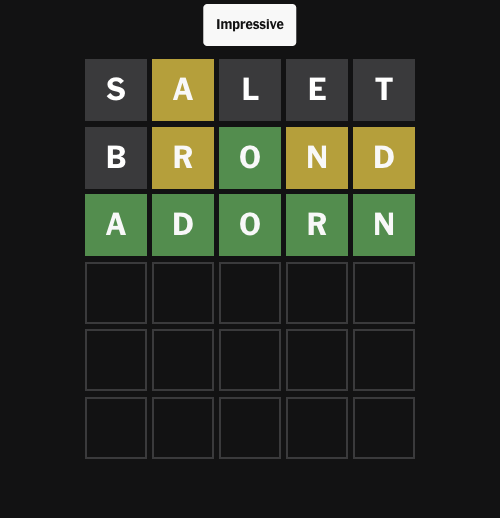

# Wordle Optimizer

A Wordle solver that searches for the decision tree needing the fewest guesses,
and a bot that uses it to play the New York Times daily puzzle.

[](https://github.com/Iva5858/wordle_optimizer/actions/workflows/tests.yml)

[](LICENSE)

**Tied for first place on the [Wordle bot leaderboard](https://freshman.dev/wordle/leaderboard)**
(entry `isaac_bot`): 7,920 total guesses over the 2,315 original answers, an
average of 3.4212, never more than 5, opening with SALET. 7,920 is the proven
minimum for normal mode with the original word lists
([Bertsimas & Paskov, *An Exact Solution to Wordle*, Operations Research 2025](https://pubsonline.informs.org/doi/10.1287/opre.2022.0434)).
24 entries share first place; none of the 942 entries is lower.

## Results



| | Games | Average | Distribution (2 / 3 / 4 / 5 / 6) | Losses |
|---|---|---|---|---|
| Leaderboard tree, original answers | 2,315 | **3.4212** | 78 / 1,225 / 971 / 41 / 0 | 0 |
| Daily bot, every real NYT answer through Oct 2026 | 1,920 | 3.4526 | 60 / 1,000 / 812 / 27 / 21 | 0 |
| Daily bot, every word NYT accepts | 14,855 | 4.3904 | 105 / 2,337 / 5,632 / 5,206 / 1,571 | 3 |

- The leaderboard tree (7,920 guesses) is built in about 7 seconds with
  `python solve.py` on an 18-core Mac.
- Every one of the 14,855 words NYT accepts is a possible answer, so the last
  row is the worst case: most of those words are obscure, which is why its
  average is higher. The bot loses only JILLS, VILLS and ZILLS (and wins SALET
  in one guess); checking all of them takes 144 s on 18 cores.

<br clear="right">

## Quick start

Requires Python 3.10+. Google Chrome is needed for the bot only.

```bash
git clone https://github.com/Iva5858/wordle_optimizer.git
cd wordle_optimizer
python -m venv .venv && source .venv/bin/activate
pip install -r requirements.txt

python automated_wordle.py      # play today's Wordle in Chrome
python assistant.py             # get suggestions while you play yourself
```

The solved trees ship with the repo, so nothing needs to be computed first.

## Usage

`solve.py`, `automated_wordle.py` and `benchmark.py` list their options with `--help`.

### `solve.py`: build a strategy

| Mode | Word lists | Writes |
|---|---|---|
| default (leaderboard tree) | original 2,315 answers / 12,972 guesses | `words/leaderboard_tree.json` and `wordle_results/leaderboard.txt` |
| `--live` (the tree the bot plays) | also every answer NYT has used, and every word NYT accepts today | `words/live_tree.json` |

`leaderboard.txt` has one line per answer in the leaderboard's upload format
(`salet,brond,aback`).

| Flag | Default | |
|---|---|---|
| `--live` | off | build the live tree instead of the leaderboard tree |
| `--start WORD ...` | `salet` | opening word(s) to try |
| `--top-starts N` | 0 | also try the N openers that look most promising before searching |
| `--width W` | 10 | search width: higher is slower but can find better trees |
| `--exact` | off | try every guess at every step, proving the minimum for the chosen opener(s); not yet timed on the full lists, expect hours or more |
| `--out FILE` | depends on `--live` | where to write the tree |

### `automated_wordle.py`: play the NYT puzzle

| Flag | |
|---|---|
| `--daily HH:MM` | keep running and play every day at this time |
| `--show` | show the browser window instead of running headless |

It clicks through cookie banners, ads and popups, plays the game, saves a
screenshot of the board after each guess to `wordle_results/screenshots/`, and
appends each game to `wordle_results/wordle_log.txt`:

```
2026-10-18 00:00
  1. SALET  01000  2384 -> 105 possible
  2. BROND  01211  105 -> 1 possible
  3. ADORN  22222  1 -> 1 possible
  Solved in 3
```

### `assistant.py`: help while you play

Suggests a word, asks which word you played and the colors you got (`2` green,
`1` yellow, `0` gray), and lists the remaining answers once there are 10 or fewer.

### `benchmark.py`: measure the bot

| Flag | Default | |
|---|---|---|
| `--words FILE` | `words/past_answers.txt` | answers to play |
| `--tree FILE` | `words/live_tree.json` | strategy to play |

### `fetch_past_answers.py`: update the real answers

Downloads every NYT answer since the first Wordle into `words/past_answers.txt`.

## How it works

A strategy is a decision tree: a guess, then for every feedback pattern, the
next guess. For a set *S* of answers that are still possible, guess *g* costs

```
cost(S, g) = |S| + Σ cost(B)   over the feedback groups B of S that g doesn't solve
```

Every answer in *S* spends this guess, and each group continues in its own
subtree. The answer list is fixed, so minimizing the total number of guesses is
the same as minimizing the average.

### The search

`wordle/search.py` runs a **depth-first branch-and-bound over an AND-OR tree**:
at each node it takes the minimum over guesses (OR), and a guess's cost is the
sum over its feedback outcomes (AND). Results are memoized per answer subset
(dynamic programming), so a subset reached by different paths is solved once.

<details>
<summary>What makes it fast</summary>

- **Precomputed feedback matrix.** The colors for every guess against every
  answer are computed once with numpy and cached in `.cache/`.
- **Exact shortcut.** A guess that splits *S* into single words is optimal:
  2|S| − 1 guesses if it is one of the possible answers, 2|S| otherwise.
- **Beam.** Guesses are ordered by the sum of their squared group sizes and
  only the most promising are tried. `--width` scales how many; `--exact`
  disables the beam.
- **Admissible lower bound.** A group of *n* answers needs at least 2*n* − 1
  guesses. A candidate is pruned as soon as its cost so far plus these bounds
  can't beat the best guess found.
- **Parallelism.** The subtrees under the opener are solved on all cores.

It is not A\*: the answer is a whole policy tree, not a path. It is not
alpha-beta either: feedback isn't an adversary, so outcomes are summed rather
than minimaxed. The closest relatives are AO\* and depth-first
branch-and-bound. The tests compare it against brute force on small word sets.

</details>

### Choosing an opener

`python solve.py --start salet --top-starts 10` (42 s):

| Opener | Total | Average |
|---|---|---|
| **SALET** | **7,920** | **3.4212** |
| SOARE | 7,997 | 3.4544 |
| ROATE | 8,000 | 3.4557 |
| RAINE | 8,003 | 3.4570 |
| RAISE | 8,015 | 3.4622 |
| ARISE | 8,043 | 3.4743 |

The pre-search ranking prefers SOARE and ROATE, but SALET wins after the full search.

### Two trees

The leaderboard tree uses the original lists so it can be compared with other
solvers. NYT has since added answers that aren't in them; GOFER and MOMMY used
to lose because the original tree didn't know them. The live tree also covers
every answer NYT has used and allows every word NYT accepts today.

### The daily bot's safety check

NYT's answer is always an allowed guess, so the bot (`wordle/player.py`) tracks
every allowed word still consistent with the feedback, not just the tree's
answers. From guess 2 on, it only plays a guess that still guarantees finding
every one of them within 6.

<details>
<summary>Details and cost</summary>

- Whether a set can be finished is searched with up to 4 guesses left and
  assumed with 5 left. Playing all 14,855 words shows the assumption holds
  everywhere except one -ILLS family (see [Limitations](#limitations)).
- Cost: the average on real answers is 3.4526 instead of 3.4276 without the check.
- Benefit: words the tree has never seen, like BIKER or CENTS, no longer lose.
  Without the check, about 1.25% of unknown words lost in a 400-word sample.

</details>

## Word lists and data files

| File | Words | |
|---|---|---|
| `words/answers.txt` | 2,315 | the original answers |
| `words/original_guesses.txt` | 10,657 | the original other allowed guesses (from [cfreshman's gist](https://gist.github.com/cfreshman/cdcdf777450c5b5301e439061d29694c)) |
| `words/current_guesses.txt` | 14,855 | every word NYT accepts today |
| `words/past_answers.txt` | 1,947 | NYT answers in order (1,920 unique; NYT now reuses some) |
| `words/leaderboard_tree.json` | | generated by `solve.py` |
| `words/live_tree.json` | | generated by `solve.py --live` |

Both trees are committed so the bot runs immediately. Allowing the newer
guesses for the leaderboard tree would give 3.4199, but the leaderboard doesn't
accept those words.

## Project structure

```
wordle_optimizer/
├── solve.py                # build a strategy tree
├── automated_wordle.py     # play the NYT puzzle in Chrome
├── assistant.py            # suggestions while you play
├── benchmark.py            # measure the bot on a list of answers
├── fetch_past_answers.py   # download real NYT answers
├── wordle/
│   ├── data.py             # word lists and file locations
│   ├── feedback.py         # the colors a guess gets, one at a time or as a matrix
│   ├── search.py           # the tree search
│   ├── tree.py             # saving, loading and following trees
│   └── player.py           # picking guesses in a live game
├── words/                  # word lists and the solved trees
├── docs/                   # README images
└── tests/                  # pytest suite
```

## Development

```bash
pip install pytest ruff     # or: pip install --group dev (pip >= 25.1), or: uv sync
python -m pytest            # about 90 s; builds a ~220 MB matrix cache in .cache/
ruff check .
ruff format .
```

## Limitations

- **JILLS, VILLS, ZILLS.** An -ILLS family can't be guaranteed after SALET.
  No NYT answer has ever ended in -LLS.
- **The safety check costs** about 0.025 guesses per game.
- **Hard mode** isn't supported.
- **NYT page changes.** A redesign can break the selectors at the top of
  `automated_wordle.py`.

## Acknowledgements

- Dimitris Bertsimas and Alex Paskov, for proving 7,920 is the minimum.
- [Jonathan Olson](https://jonathanolson.net/experiments/optimal-wordle-solutions),
  whose independent optimal results served as a benchmark. This project's
  search was written independently.
- [cfreshman](https://freshman.dev/wordle/leaderboard), for publishing the original word lists and running the leaderboard.

## License

MIT, see [LICENSE](LICENSE).
